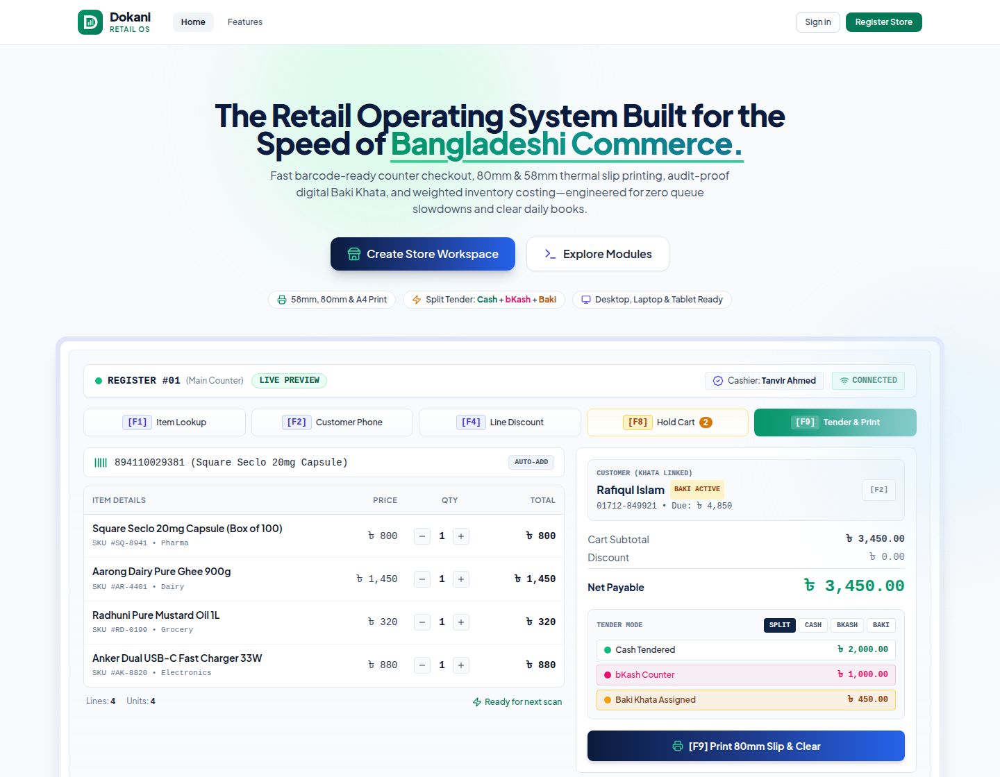

# Dokani — Retail POS, Inventory & Digital Baki Ledger

[](https://github.com/rohan-bhau/dokani/actions/workflows/ci.yml)
[](https://dokani-delta.vercel.app)
[](https://dokani-2jve.onrender.com/health)
[](https://pnpm.io)

Dokani is a multi-tenant retail Point of Sale (POS), inventory valuation, and customer credit (*Baki Khata*) management platform built for retail merchants, pharmacies, grocery stores, and electronics shops in Bangladesh.

- **Live Web Application:** [https://dokani-delta.vercel.app](https://dokani-delta.vercel.app)
- **API Health Check:** [https://dokani-2jve.onrender.com/health](https://dokani-2jve.onrender.com/health)



---

## Tech Stack

### Frontend


### Backend & Data


### Security, Payments, Testing & Infrastructure


---

## Core Capabilities

- **Keyboard-First POS Terminal:** Fast barcode and SKU lookup (`F1`), customer khata linking (`F2`), line-item discounts (`F4`), multi-cart holding (`F8`), and instant checkout with receipt printing (`F9`).
- **Multi-Tender Checkout & Online Settlement:** Accept single or split payments across Cash, bKash, SSLCommerz, and Customer Baki, with shareable online payment links and real-time Socket.io settlement updates.
- **Thermal & Formal Invoice Printing:** Built-in print layouts formatted for 80mm thermal rolls, 58mm compact rolls, and formal A4 customer invoices.
- **Atomic Inventory & Weighted Average Costing (WAC):** Row-locked PostgreSQL transactions prevent negative stock races under concurrent checkouts, while supplier purchase bills automatically recalculate blended unit costs.
- **Digital Baki Khata (Customer Credit Ledger):** Track customer balances by phone number, enforce configurable credit ceilings at checkout, and record timestamped partial repayments.
- **Purchases, Returns & Daily Expenses:** Manage supplier bills, item-level sales returns that restore shelf stock, and daily store operating expenses for accurate net profit reporting.
- **Multi-Tenant Isolation & Role-Based Access Control:** Every query and mutation is scoped to the authenticated store workspace on the server, enforcing granular permissions across `Owner`, `Manager`, `Cashier`, and `Viewer` roles.

---

## Workspace Dependencies

### 1. Web Client (`@dokani/app`)

| Package | Version | Purpose |
| :--- | :--- | :--- |
| `next` | `15.5.29` | React App Router framework, routing, font optimization, and API proxy rewrites |
| `react` / `react-dom` | `19.3.1` | Core UI rendering library |
| `@reduxjs/toolkit` | `^2.5.0` | Global auth slice and RTK Query API data fetching, caching, and token refresh |
| `react-redux` | `^9.2.0` | Official React bindings for Redux store |
| `socket.io-client` | `^4.8.4` | Real-time WebSocket client for instant payment confirmation events |
| `lucide-react` | `^0.473.0` | Consistent SVG icon set across POS, dashboard, and landing screens |
| `tailwindcss` | `^3.4.17` | Utility-first CSS styling and print layout tokens |
| `clsx` / `tailwind-merge` | `^2.1.1` / `^2.6.0` | Conditional class composition and conflict-free Tailwind class merging |
| `postcss` / `autoprefixer` | `^8.5.1` / `^10.4.20` | CSS build pipeline and vendor prefixing |
| `typescript` | `^5.7.3` | Strict static type checking |
| `@dokani/shared` | `workspace:*` | Shared Zod schemas, permissions, and domain types |

### 2. Backend API (`@dokani/server`)

| Package | Version | Purpose |
| :--- | :--- | :--- |
| `express` | `^4.21.2` | REST API routing, middleware pipeline, and health endpoints |
| `@prisma/client` / `prisma` | `^6.4.1` | PostgreSQL ORM, schema migrations, and row-locked atomic transactions |
| `ioredis` | `^5.6.0` | Redis client for session/token state and service health checks |
| `bullmq` | `^6.5.1` | Redis-backed background queue processing |
| `socket.io` | `^4.8.4` | Authenticated WebSocket server scoped per tenant workspace |
| `zod` | `^3.24.2` | Strict validation for request bodies, query params, route params, and env config |
| `argon2` | `^0.41.1` | Argon2id password hashing and verification |
| `jsonwebtoken` | `^9.0.2` | Access and refresh JWT issuance and verification |
| `helmet` | `^8.0.0` | Secure HTTP response headers (CSP, HSTS, frameguard) |
| `cors` | `^2.8.5` | Explicit origin allowlist with credentials support |
| `pino` / `pino-http` / `pino-pretty` | `^9.6.0` / `^10.4.0` | Structured JSON server and HTTP request logging |
| `sslcommerz-lts` | `^1.2.0` | SSLCommerz payment session initiation and IPN verification |
| `dotenv` | `^16.4.7` | Environment variable loading prior to Zod startup validation |
| `jest` / `ts-jest` / `supertest` | `^29.7.0` / `^29.2.5` / `^7.0.0` | Integration, concurrency, RBAC, tenant-isolation, and webhook test suites |
| `tsx` | `^4.19.3` | TypeScript execution for local watch mode and database seed scripts |
| `@dokani/shared` | `workspace:*` | Shared contracts and permission constants |

### 3. Shared Package (`@dokani/shared`)

| Package | Version | Purpose |
| :--- | :--- | :--- |
| `zod` | `^3.24.2` | Shared validation schemas and inferred TypeScript types across frontend and backend |
| `typescript` | `^5.7.3` | ESM TypeScript compilation (`dist/`) |

---

## Monorepo Structure

```text
dokani/
├── app/                  # Next.js 15 web client (@dokani/app)
│   ├── src/app/          # App Router pages (POS, inventory, customers, sales, settings)
│   ├── src/components/   # Shared UI, receipt print layouts, and homepage modules
│   ├── src/hooks/        # Custom hooks (real-time Socket.io listener)
│   └── src/store/        # Redux Toolkit slices & RTK Query API definitions
├── server/               # Express + Prisma + Socket.io API (@dokani/server)
│   ├── prisma/           # PostgreSQL schema and SQL migrations
│   ├── src/config/       # Zod env validation, Prisma singleton, Redis, and logger
│   ├── src/middleware/   # Auth, tenant isolation, permission guards, error handler
│   ├── src/modules/      # Feature modules (auth, pos, sales, products, inventory, etc.)
│   └── tests/            # Integration, concurrency, tenant-isolation, and payment tests
└── packages/
    └── shared/           # Shared Zod schemas, permissions, and types (@dokani/shared)
```

---

## Local Development Setup

### Prerequisites

- **Node.js** `>= 22.x`
- **pnpm** `12.x`
- **PostgreSQL** `16+` and **Redis** `7+` (or Docker with `docker compose up -d`)

### 1. Clone and Install Dependencies

```bash
git clone https://github.com/rohan-bhau/dokani.git
cd dokani
pnpm install
```

### 2. Configure Environment Variables

Copy the example files in both `server/` and `app/` and set your local values:

```bash
cp server/.env.example server/.env
cp app/.env.example app/.env
```

- **`server/.env`:** `NODE_ENV`, `PORT`, `DATABASE_URL`, `REDIS_URL`, `JWT_ACCESS_SECRET` (min 32 chars), `JWT_REFRESH_SECRET` (min 32 chars), `CORS_ORIGIN`, `SERVER_URL`, plus optional `BKASH_*` and `SSLCOMMERZ_*` sandbox keys.
- **`app/.env`:** `NEXT_PUBLIC_API_URL=http://localhost:5000` and `NEXT_PUBLIC_SOCKET_URL=http://localhost:5000`.

### 3. Build Shared Package & Prepare Database

```bash
pnpm --filter @dokani/shared build
pnpm --filter @dokani/server db:generate
pnpm --filter @dokani/server db:migrate
pnpm --filter @dokani/server db:seed
```

### 4. Start Development Servers

```bash
pnpm dev
```

- **Web Client:** `http://localhost:3000`
- **API Server:** `http://localhost:5000`
- **Health Checks:** `http://localhost:5000/health` (lightweight uptime check) and `http://localhost:5000/api/v1/health` (DB + Redis readiness)

---

## Testing & Verification

```bash
# Typecheck all workspace packages
pnpm typecheck

# Run backend integration, concurrency, and RBAC test suites (9 suites, 53 tests)
pnpm --filter @dokani/server test

# Production builds
pnpm build
pnpm --filter @dokani/app build
```

---

## Author

Built and maintained by **Rohan** — Full Stack Developer based in Dhaka, Bangladesh.

[](https://github.com/rohan-bhau)
[](https://github.com/rohan-bhau/dokani)
